# Tutorial: BSEVITA Geräteverleih (Lagerverwaltung)

Dieses Tutorial erklärt die Bedienung der Lagerverwaltungs-App Schritt für Schritt, mit allen Seiten der Anwendung. Die Screenshots stammen aus der laufenden Anwendung mit den Testdaten aus `Testdaten.sql`.

## Inhalt

1. [Überblick](#1-überblick)
2. [Anwendung starten und Testkonten](#2-anwendung-starten-und-testkonten)
3. [Erste Schritte](#3-erste-schritte)
4. [Übersicht (Startseite)](#4-übersicht-startseite)
5. [Katalog](#5-katalog)
6. [Mein Raum](#6-mein-raum)
7. [Wareneingang](#7-wareneingang)
8. [Aus dem Lager holen](#8-aus-dem-lager-holen)
9. [Verleihen](#9-verleihen)
10. [Rückgabe](#10-rückgabe)
11. [Freigaben](#11-freigaben)
12. [Profil](#12-profil)
13. [Administration](#13-administration)
14. [Mobile Ansicht](#14-mobile-ansicht)

---

## 1. Überblick

Mit der App verwaltet die Schule, welche Geräte und Materialien sich in welchem Raum befinden. Jede Änderung am Bestand wird als **Lagerbewegung** gebucht und bleibt in der Historie nachvollziehbar.

### Rollen und Zuständigkeit

Was jemand sehen und tun darf, hängt von zwei Dingen ab:

* **Admin-Rolle** (z. B. „Administrator“): Zugriff auf Benutzerverwaltung, Stammdaten, Lagerbestand und Historie. Entscheidend ist allein das Häkchen **Admin-Rechte** der Rolle, nicht ihr Name.
* **Raumverantwortung**: Jeder Raum hat **höchstens eine** verantwortliche Person, eine Person kann aber für **mehrere Räume** verantwortlich sein (z. B. eine Lehrerin für zwei Labore). Nur die verantwortliche Person darf aus ihren Räumen buchen und Anfragen für ihre Räume freigeben.
* **Ausnahme Lager**: Für jedes **Lager** (Raumart mit „lager“ im Namen, z. B. Hauptlager **HL** und Umbuchungslager **UL**) dürfen zusätzlich **alle Admins** buchen und freigeben, auch ohne eigenen Raum: aus einem Lager verleihen (z. B. Geräte aus dem HL einem Labor zuweisen), Rückgaben im UL übernehmen und Anfragen der Lager zurückziehen. Das gilt auch für Anfragen, die ein Admin selbst gestellt hat (z. B. eine Einlagerung von UL nach HL): Er kann sie unter **Freigaben** selbst bestätigen. Für alle anderen Räume gilt auch für Admins: Buchen darf nur die verantwortliche Person.

| Menüpunkt | Alle angemeldeten Personen | Nur mit eigenem Raum | Nur Admins |
|---|:---:|:---:|:---:|
| Übersicht, Katalog, Verleihen | ✔ | | |
| Rückgabe (nicht für eine Person, die nur das Umbuchungslager hat) | ✔ | | |
| Mein Raum, Wareneingang, Aus dem Lager | | ✔ | |
| Freigaben | | ✔ | ✔ (auch ohne Raum, für die Lager) |
| Benutzer und alle *Stammdaten* (Kategorien, Hersteller, Raumliste, Raumarten, Bewegungsarten, Lagerbestand, Historie) | | | ✔ |

> Wer eine Seite ohne Berechtigung aufruft (z. B. `/Admin` als Lehrerin), sieht „Zugriff verweigert“:
>
> 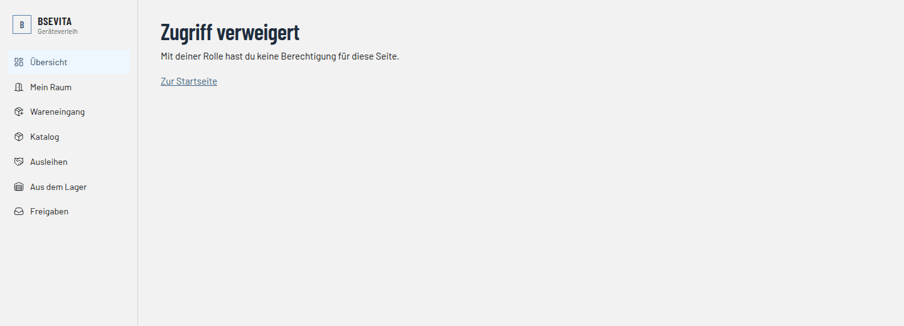

> Wer keinen Raum hat und **Mein Raum**, **Wareneingang** oder **Aus dem Lager holen** aufruft (z. B. über eine Adresse), sieht nicht „Zugriff verweigert“, sondern den Hinweis „Kein Raum zugewiesen“. Ein Admin kann in der Raumliste einen Raum zuweisen. Bei **Verleihen** und **Rückgabe** steht ein entsprechender Hinweis auf der Seite selbst.

> Eine Adresse oder ein Eintrag, den es nicht (mehr) gibt (z. B. ein gelöschter Gegenstand), zeigt die Seite „Seite nicht gefunden“ mit einem Link zur Startseite statt einer leeren Seite.

---

## 2. Anwendung starten und Testkonten

1. Datenbank anlegen: `Docs/Datenbankskript.sql` in SQL Server Management Studio ausführen. Das Skript legt die Datenbank `Lagerverwaltung` mit allen Tabellen an.
2. *(Optional)* Testdaten einspielen: `Lagerverwaltungsapp-MatthiasUtrata/Testdaten.sql` ausführen.
3. Die Verbindung steht in `appsettings.json` unter `ConnectionStrings:DefaultConnection` (Standard: LocalDB `(localdb)\MSSQLLocalDB`).
4. `Lagerverwaltung.slnx` in Visual Studio öffnen und starten, oder im Projektordner `dotnet run` ausführen.
5. Im Browser öffnen: `http://localhost:5191` (Profil „http“) bzw. `https://localhost:7019` (Profil „https“).

**Testkonten** (aus `Testdaten.sql`):

| Benutzername | Passwort | Rolle | Verantwortlich für Raum |
|---|---|---|---|
| `admin` | `admin` | Administrator | – |
| `hauptlager` | `hauptlager` | LehrerIn | HL (Hauptlager) |
| `umbuchungslager` | `umbuchungslager` | LehrerIn | UL (Umbuchungslager) |
| `wfuchs` | `Test1234` | Administrator | KONF (Konferenzzimmer) |
| `meder` | `Test1234` | Administrator | SEK (Verwaltung) |
| `ahuber` | `Test1234` | LehrerIn | 101 und 104 (Klassenzimmer) |
| `tgruber` | `Test1234` | LehrerIn | 102 und 105 (Klassenzimmer) |
| `swagner` | `Test1234` | LehrerIn | 103 (Klassenzimmer) und 206 (Fachraum) |
| `jpichler` | `Test1234` | LehrerIn | 310 und 313 (Labor) |
| `eberger` | `Test1234` | LehrerIn | BIB (Bibliothek) und 106 (Klassenzimmer) |
| `mbauer` | `Test1234` | Laborvorstand | 309 (Labor) |
| `kwimmer` | `Test1234` | LehrerIn | – |

Alle weiteren Testkonten haben ebenfalls das Passwort `Test1234`.

---

## 3. Erste Schritte

### 3.1 Registrierung des ersten Admins

Ist die Datenbank noch leer (kein einziger Benutzer), zeigt die App statt der Anmeldung die **Registrierung**. Die erste Person, die sich registriert, wird automatisch **Administrator** und legt danach alle weiteren Benutzer an.

1. Vorname, Nachname, Benutzername (max. 20 Zeichen) und E-Mail eingeben.
2. Passwort (mindestens 5 Zeichen) zweimal eingeben.
3. **Registrieren** klicken. Danach sind Sie angemeldet und landen auf der Übersicht.

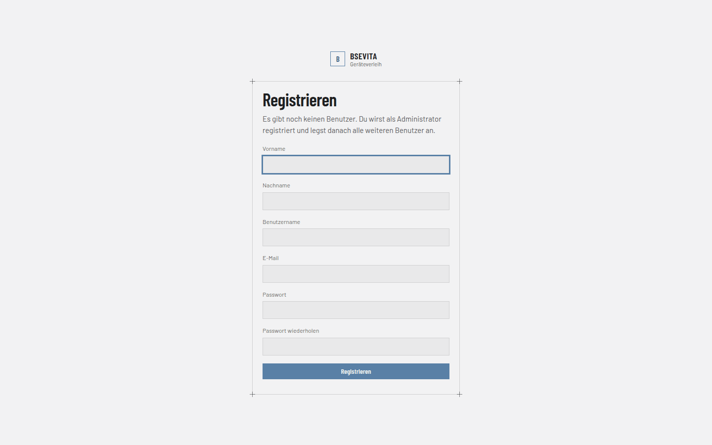

Sobald es einen Benutzer gibt, ist die Registrierung gesperrt. Neue Konten legt dann nur noch ein Admin unter **Benutzer** an (siehe [13.1](#131-benutzer)).

### 3.2 Anmelden und Abmelden

1. Benutzername und Passwort eingeben.
2. **Anmelden** klicken.

Bei falschen Daten erscheint „Benutzername oder Passwort ist falsch.“:

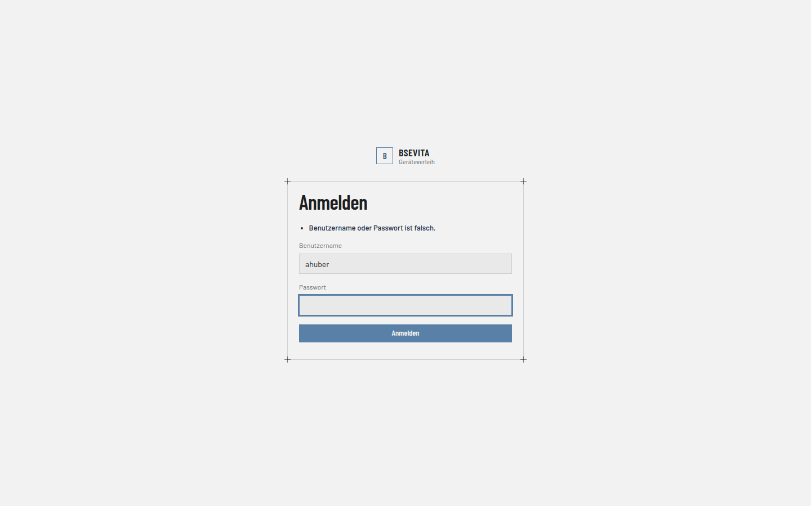

Nach **5 fehlgeschlagenen Anmeldungen** mit demselben Benutzernamen ist dieser für 1 Minute gesperrt. Jeder weitere Fehlversuch nach Ablauf der Sperre verlängert sie um eine Minute (2, 3, 4 … Minuten). Das gilt auch für Benutzernamen, die es nicht gibt. Alle Schreibweisen, unter denen die Anmeldung denselben Benutzer findet (z. B. „admin“, „Admin“ oder „ａdmin“ mit einem breiten a), zählen zusammen. Die Seite zeigt dann „Zu viele fehlgeschlagene Anmeldeversuche …“ mit der Restzeit, die live herunterzählt. Solange sie läuft, ist das Formular deaktiviert und auch das richtige Passwort wird nicht geprüft. Nach dem Ablauf wird das Formular automatisch wieder freigegeben. Eine erfolgreiche Anmeldung setzt den Zähler zurück, ein Neustart der Anwendung ebenfalls.

Zum **Abmelden** klicken Sie unten in der Seitenleiste auf das Pfeil-Symbol neben Ihrem Namen (mobil: unter **Profil → Abmelden**).

### 3.3 Aufbau der Oberfläche

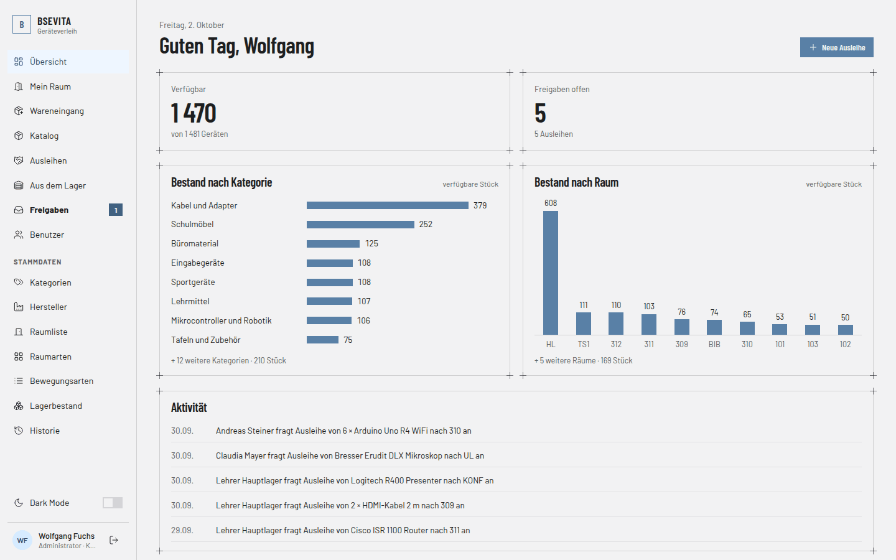

* **Seitenleiste links** (ab ca. 992 px Bildschirmbreite): alle Menüpunkte, die Sie mit Ihrer Rolle und Ihrem Raum sehen dürfen. Der aktuelle Menüpunkt ist hervorgehoben.
* **Badge bei „Freigaben“**: Die Zahl zeigt, wie viele Anfragen auf **Ihre** Freigabe warten. Der Menüpunkt ist dann fett.
* **Stammdaten**: Dieser Abschnitt erscheint nur für Admins.
* **Dark Mode**: Der Schalter unten wechselt zwischen hellem und dunklem Design. Der Browser merkt sich die Wahl. Ohne gespeicherte Wahl gilt die Einstellung des Betriebssystems.
* **Name und Avatar** unten führen zu Ihrem [Profil](#12-profil). Daneben steht Ihre Rolle und gegebenenfalls Ihr Raum (z. B. „Administrator · KONF“, bei mehreren Räumen „LehrerIn · 310, 313“).

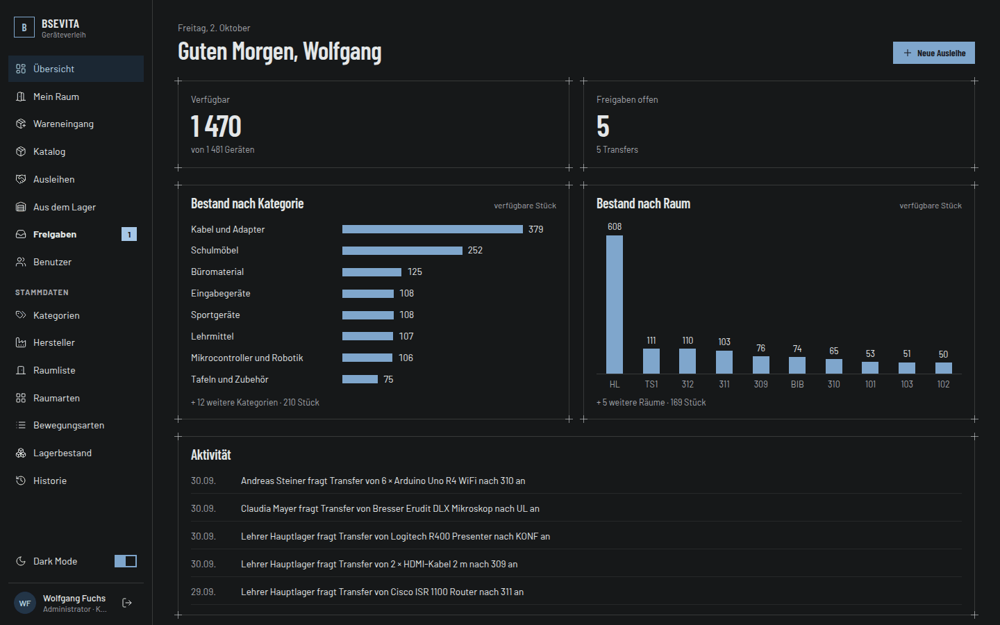

Auf schmalen Bildschirmen (Smartphone) ersetzt eine **Tab-Leiste unten** die Seitenleiste, siehe [Mobile Ansicht](#14-mobile-ansicht).

---

## 4. Übersicht (Startseite)

Die Übersicht ist die Startseite nach der Anmeldung. Oben stehen das Datum und eine Begrüßung je nach Tageszeit, rechts der Schnellzugriff **Gerät verleihen**.

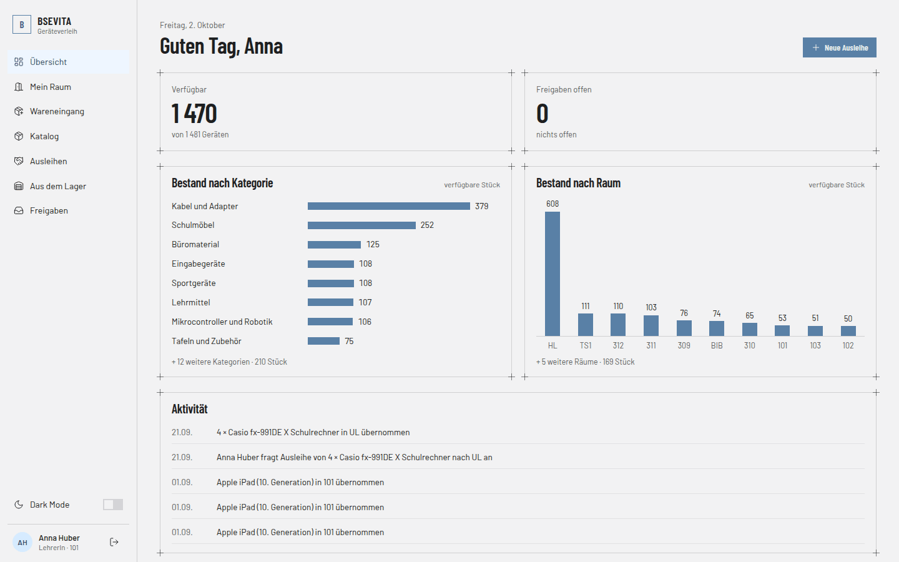

| Bereich | Inhalt |
|---|---|
| **Verfügbar** | Stück, die gerade in Räumen liegen. Darunter „von … Geräten“: das sind alle Stück inklusive derer, die gerade unterwegs sind. |
| **Freigaben offen** | Anzahl offener Ausleihen. Admins sehen alle, alle anderen nur die für ihre eigenen Räume. |
| **Bestand nach Kategorie** | Balkendiagramm der verfügbaren Stück je Kategorie (die größten acht). Ein **Klick auf einen Balken** öffnet den Katalog, gefiltert nach dieser Kategorie. Beim Darüberfahren zeigt ein Hinweis den Anteil am Gesamtbestand. |
| **Bestand nach Raum** | Säulendiagramm je Raum (die größten zehn). Ein **Klick auf eine Säule** öffnet den Katalog, gefiltert nach diesem Raum. |
| **Aktivität** | Die fünf neuesten Buchungen. Admins sehen alle, alle anderen nur ihre eigenen und die ihres Raums. |

---

## 5. Katalog

Der Katalog listet **alle Gegenstände** mit Seriennummer, Standort, Status und Hinweis (z. B. „unterwegs nach 311“). Ihn sehen alle angemeldeten Personen.

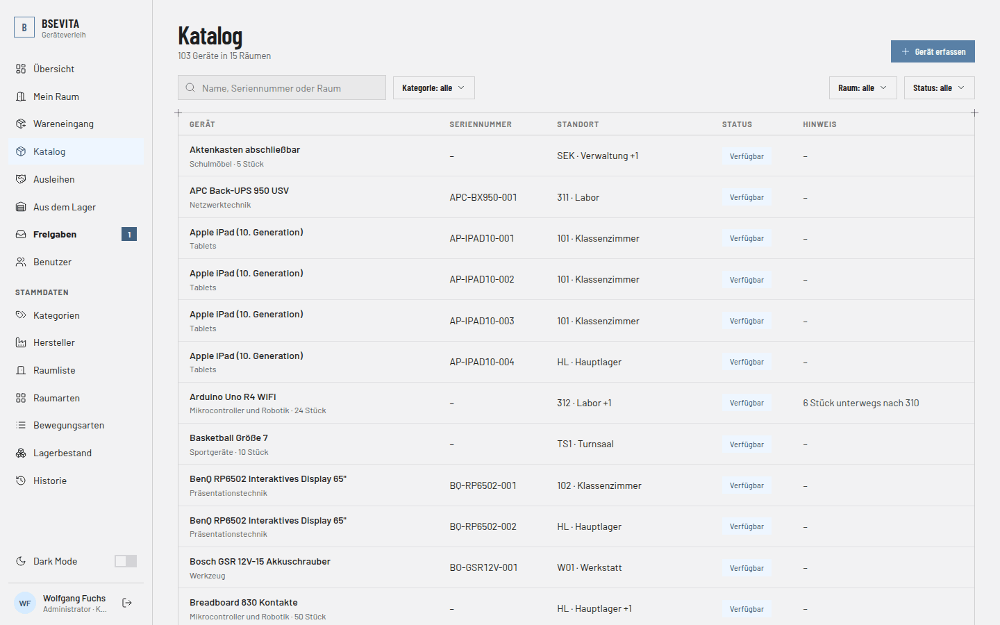

### 5.1 Suchen und filtern

* **Suchfeld**: Name, Seriennummer oder Raum eingeben und mit **Enter** bestätigen.
* **Kategorie**, **Raum** und **Status** filtern sofort bei Auswahl.
* Kommen Sie über die Anzahl der Gegenstände bei einem [Hersteller](#hersteller), ist zusätzlich nach **Hersteller** gefiltert. **Hersteller: alle** hebt diesen Filter auf.
* Ist eine Suche oder ein Filter aktiv, erscheint daneben ein **×** (**Filter zurücksetzen**), das alle Filter aufhebt. Auf dem Smartphone sind Suche und Kategorie immer sichtbar, **Raum** und **Status** nur, solange sie aktiv sind.
* Status-Werte: **Verfügbar** (liegt in einem Raum), **In Ausleihe** (gerade unterwegs), **Kein Bestand** (im Katalog, aber nirgends gebucht).

Beispiel: alle Geräte, die gerade unterwegs sind:

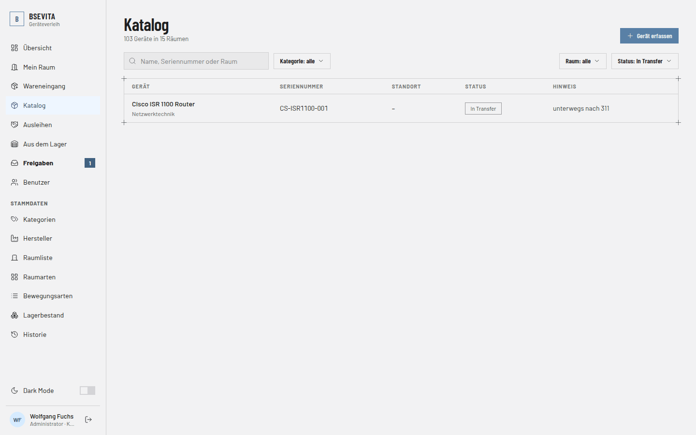

Ein Klick auf eine Zeile öffnet die Details des Gegenstands.

### 5.2 Gegenstand-Details

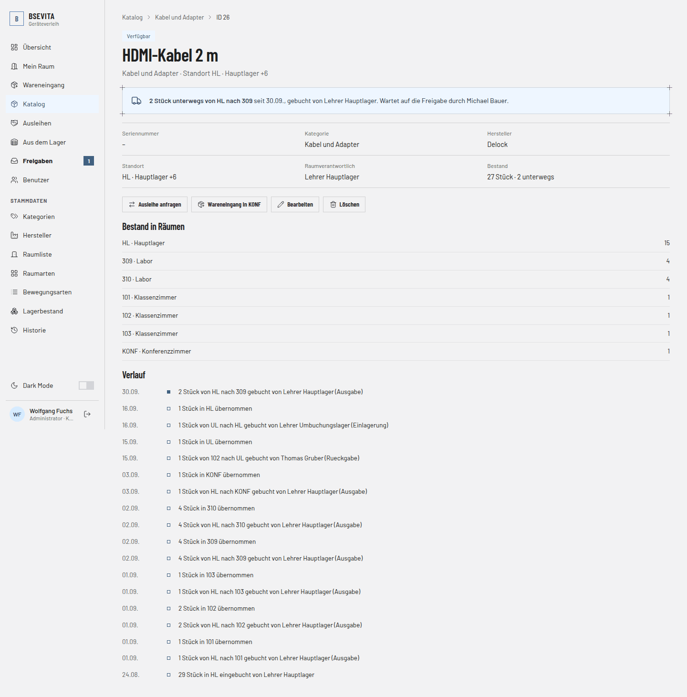

Die Detailseite zeigt:

* **Status** und einen Hinweis, falls gerade etwas unterwegs ist (mit Datum, Buchendem und wer freigeben muss).
* **Seriennummer, Kategorie, Hersteller, Standort, Raumverantwortliche Person, Bestand**.
* **Bestand in Räumen**: Gegenstände ohne Seriennummer können in mehreren Räumen liegen.
* **Verlauf**: alle Buchungen dieses Gegenstands, die neueste zuerst.
* Je nach Berechtigung die Buttons **An anderen Raum verleihen**, **Aus Lager &lt;Lager&gt; holen**, **Wareneingang in &lt;Ihr Raum&gt;** (bei mehreren eigenen Räumen nur **Wareneingang**, der Raum wird dann im Formular gewählt), **Freigeben** (wenn Sie eine offene Anfrage freigeben müssen), sowie für Admins **Bearbeiten** und **Löschen**. Auf dem Smartphone heißen die ersten drei kurz **Verleihen**, **Holen** und **Einbuchen**.
* Die Buttons zum Verleihen, Holen und für den Wareneingang öffnen die jeweilige Seite mit dem Gerät als Vorauswahl. **Verleihen** gibt es, wenn das Gerät in Ihrem Raum liegt. Admins sehen außerdem **Aus Lager &lt;Lager&gt; verleihen**, wenn das Gerät in einem Lager liegt, und **Freigeben** auch bei offenen Anfragen eines Lagers. **Aus Lager … holen** bezieht sich auf das Lager mit dem größten Bestand dieses Geräts (es braucht eine verantwortliche Person).
* Liegt das Gerät nur in normalen Räumen (nicht in einem Lager und nicht in Ihrem Raum), erscheint stattdessen ein Hinweis, in welchen Räumen es liegt und wer dort verantwortlich ist: Holen geht nur aus einem Lager, verlegen kann es nur die verantwortliche Person.

### 5.3 Gegenstand erfassen, bearbeiten, löschen (nur Admin)

**Erfassen:** Im Katalog oben rechts auf **Gerät erfassen** klicken.

1. **Bezeichnung** eingeben (Pflicht, max. 100 Zeichen).
2. **Seriennummer** eingeben, wenn es sich um ein einzelnes, eindeutiges Gerät handelt (max. 50 Zeichen, muss eindeutig sein, sonst erscheint „Diese Seriennummer ist bereits vergeben.“). Leer lassen für Mengenartikel wie Kabel oder Möbel.
3. **Kategorie** und **Hersteller** auswählen.
4. **Anlegen** klicken.

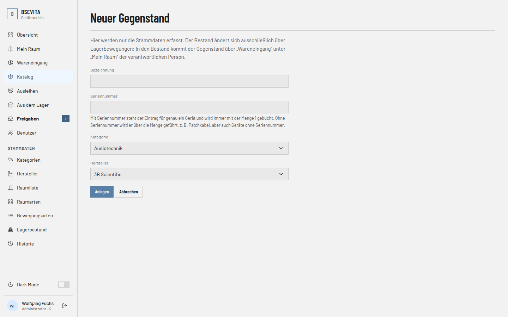

> Hier werden nur die **Stammdaten** erfasst. In den Bestand kommt der Gegenstand erst über einen [Wareneingang](#7-wareneingang) der raumverantwortlichen Person.

**Bearbeiten:** In den Details auf **Bearbeiten** klicken. Ob ein Gegenstand eine Seriennummer hat, lässt sich nur ändern, solange er weder Bestand noch Lagerbewegungen hat.

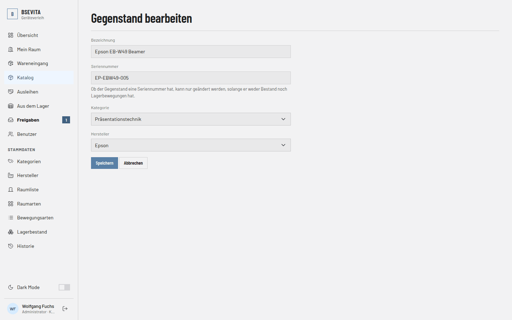

**Löschen:** In den Details auf **Löschen** klicken. Gelöscht werden kann ein Gegenstand nur, wenn er **keinen Bestand** mehr hat und in **keiner Lagerbewegung** vorkommt (sonst ginge die Historie verloren). Andernfalls erklärt die Seite, warum es nicht geht:

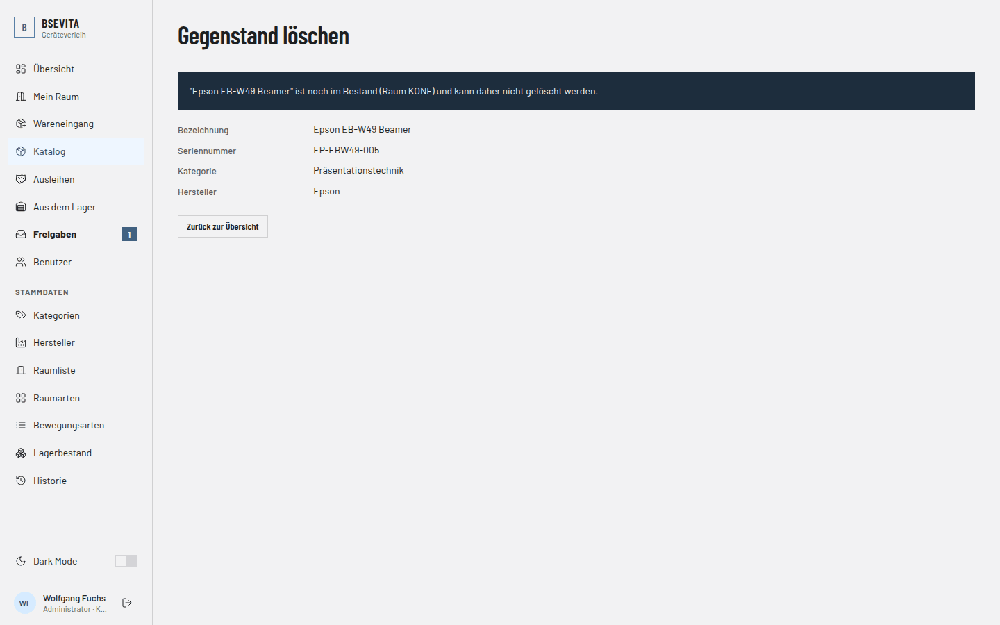

---

## 6. Mein Raum

*Nur für Personen mit eigenem Raum.* Hier sehen Sie alles zu dem Raum, für den Sie verantwortlich sind.

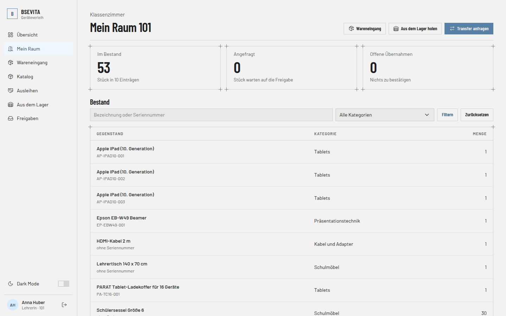

* Sind Sie für **mehrere Räume** verantwortlich (Testkonto `jpichler`: 310 und 313), stehen unter der Überschrift Karten mit Ihren Räumen. Ein Klick zeigt den jeweiligen Raum, zuerst ist der mit der kleinsten Raumnummer gewählt. Alles auf der Seite bezieht sich auf den gewählten Raum.
* Oben rechts die Aktionen **Wareneingang**, **Aus dem Lager holen**, **Zurückgeben** und **Gerät verleihen**. Sie öffnen den Ablauf gleich für den gewählten Raum.
* **Im Bestand**: Stück und Anzahl der Einträge im Raum.
* **Angefragt**: Stück, die Sie aus dem Raum abgegeben (verliehen oder zurückgegeben) oder aus einem Lager angefragt haben und die noch auf die Freigabe warten.
* **Offene Übernahmen**: Anfragen, die **Sie** freigeben müssen, mit dem Link **Jetzt bestätigen**.
* **Bestand**: Tabelle aller Gegenstände im Raum. Mit Suchfeld und Kategorie-Auswahl filtern Sie, **Zurücksetzen** hebt den Filter auf.

Sobald Anfragen offen sind, erscheint zusätzlich die Tabelle **„Angefragt, noch nicht freigegeben“**:

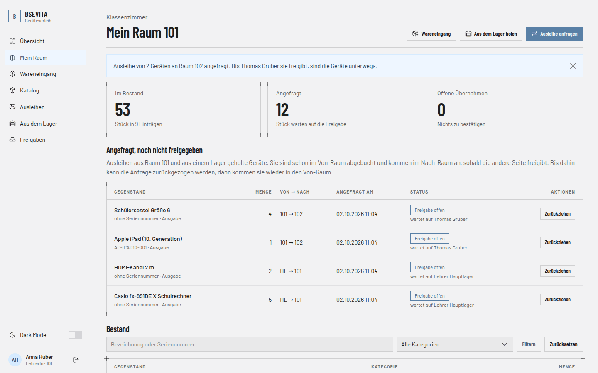

Die Mengen sind bereits im Von-Raum abgebucht und kommen im Nach-Raum an, sobald die andere Seite freigibt. Bis dahin können Sie eine Anfrage mit **Zurückziehen** rückgängig machen. Nach einer Sicherheitsabfrage kommt die Menge wieder in den Von-Raum, und die Bewegung bleibt als „Storniert“ in der Historie.

---

## 7. Wareneingang

*Nur für Personen mit eigenem Raum.* Mit dem Wareneingang kommen **neue Gegenstände von außen** (z. B. nach einer Lieferung) in den Bestand Ihres Raums.

1. Menüpunkt **Wareneingang** öffnen (oder in den Gegenstand-Details **Wareneingang in &lt;Raum&gt;** klicken, dann ist der Gegenstand schon ausgewählt).
   * Bei mehreren eigenen Räumen wählen Sie oben bei **Einbuchen in** den Raum. Kommen Sie über „Mein Raum“, ist dieser Raum schon gewählt.
2. **Gegenstand** aus der Liste wählen: Im Suchfeld Name oder Seriennummer eingeben (oder mit einem USB-Handscanner einlesen, **Enter** wählt den ersten Treffer), bei Bedarf über **Kategorie** eingrenzen und in der Zeile auf **Auswählen** klicken. Geräte mit Seriennummer, die schon in einem Raum liegen oder unterwegs sind, fehlen in der Liste.
3. **Menge** eingeben (bei Geräten mit Seriennummer immer 1). Von einem Gegenstand kann es in allen Räumen und unterwegs zusammen höchstens **100.000 Stück** geben, eine größere Menge lehnt die App mit einer Meldung ab.
4. **Bewegungsart** prüfen (vorausgewählt: „Wareneingang“).
5. **Einbuchen** klicken.

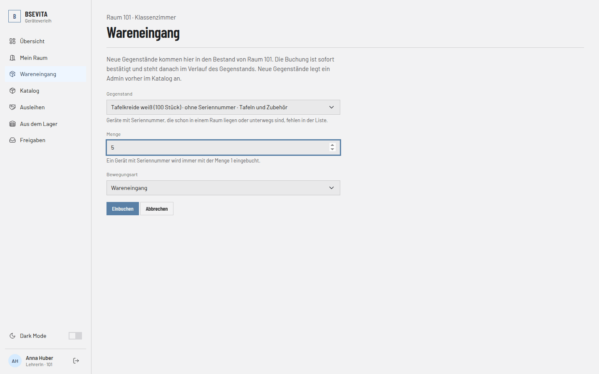

Die Buchung ist **sofort bestätigt**, eine Freigabe ist nicht nötig. Danach erscheint eine Bestätigung unter „Mein Raum“:

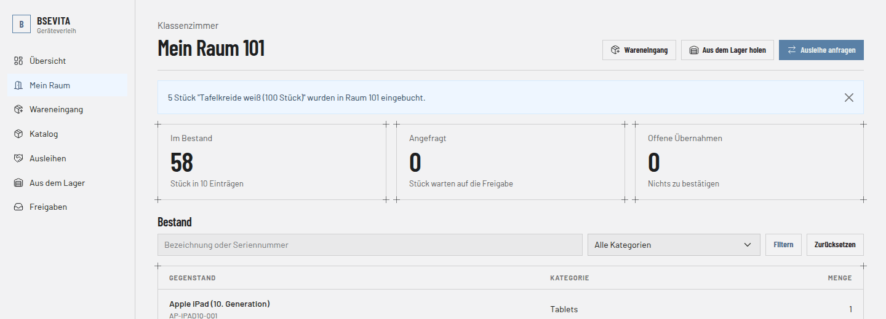

> Gibt es den Gegenstand noch nicht im Katalog, muss ihn zuerst ein Admin [erfassen](#53-gegenstand-erfassen-bearbeiten-löschen-nur-admin).

---

## 8. Aus dem Lager holen

*Nur für Personen mit eigenem Raum.* Hier fordern Sie Geräte aus einem Lager (Hauptlager **HL** oder Umbuchungslager **UL**) für Ihren eigenen Raum an. Lager, für die Sie selbst verantwortlich sind, stehen hier nicht, aus ihnen buchen Sie mit [Verleihen](#9-verleihen) um.

1. Menüpunkt **Aus dem Lager** öffnen.
2. Oben das **Lager** anklicken (bei jeder Karte steht, wer freigibt).

   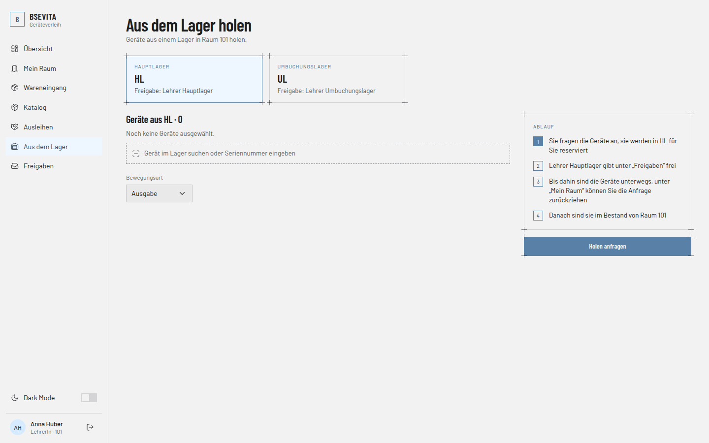

3. Im Suchfeld Name oder Seriennummer eingeben oder mit einem USB-Handscanner einlesen. Ein Klick auf einen Vorschlag fügt das Gerät hinzu, **Enter** übernimmt den ersten Vorschlag. Alternativ klappen Sie mit **Aus dem Bestand von &lt;Lager&gt; auswählen** die Bestandsliste des Lagers auf (solange noch nichts gewählt ist, ist sie offen), filtern sie nach **Kategorie** und klicken bei einem Gerät auf **Hinzufügen**. Kommen Sie über **Aus Lager … holen** aus den Gerätedetails, ist das Gerät schon ausgewählt.
4. Bei Mengenartikeln die **Menge** eintragen (rechts steht „von …“, also wie viel im Lager liegt). Mit **×** entfernen Sie ein Gerät wieder aus der Liste.
5. **Bewegungsart** wählen (Standard: „Ausgabe“). Bei mehreren eigenen Räumen wählen Sie daneben bei **Holen nach**, in welchen Raum die Geräte kommen.
6. **Holen anfragen** klicken.

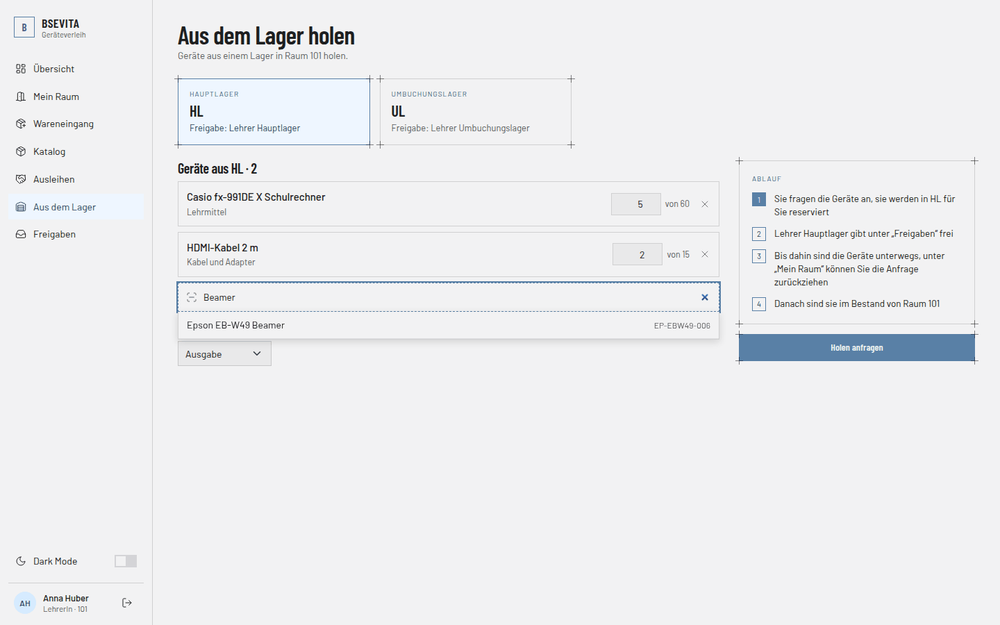

Der Kasten **Ablauf** rechts fasst zusammen, was danach passiert:

1. Die Geräte werden sofort im Lager abgebucht (für Sie reserviert).
2. Die verantwortliche Person des Lagers oder ein Admin gibt unter **Freigaben** frei.
3. Bis dahin sind die Geräte unterwegs. Unter **Mein Raum** können Sie die Anfrage zurückziehen.
4. Nach der Freigabe sind die Geräte im Bestand Ihres Raums.

Alle Positionen werden **gemeinsam** gebucht: Ist eine Menge ungültig, wird gar nichts gebucht und eine Fehlermeldung erklärt den Grund.

---

## 9. Verleihen

Mit **Verleihen** (bzw. **Gerät verleihen** unter „Mein Raum“ oder auf der Übersicht) geben Sie Geräte **aus Ihrem Raum an einen anderen Raum** weiter. Die Seite heißt **Geräte verleihen**.

0. *Bei mehreren eigenen Räumen und für Admins:* Oben bei **Verleihen aus** wählen Sie, aus welchem Ihrer Räume (als „Ihr Raum“ markiert) oder, als Admin, aus welchem **Lager** (HL, UL) Sie verleihen. Die Seite lädt dann den Bestand dieses Raums. So weisen Admins z. B. Geräte aus dem Hauptlager einem Labor zu oder stellen sie einer Lehrerin in ihrem Raum zur Übernahme bereit. Verleiht ein Admin aus einem Lager, gibt es seine eigenen Räume nicht als Ziel, dafür ist [Aus dem Lager holen](#8-aus-dem-lager-holen) da.
1. Bei **Verleihen an** den Zielraum wählen. Angeboten werden nur Räume mit verantwortlicher Person, denn diese muss die Übernahme bestätigen. Ist der Zielraum ein **anderer eigener Raum** (dort steht „Ihr Raum“), braucht es keine Freigabe: Die Geräte werden sofort umgebucht, die Zusammenfassung zeigt das bei **Benötigte Freigabe** an und die Bestätigung lautet z. B. „2 Geräte von Raum 310 nach Raum 313 umgebucht.“
2. **Bewegungsart** wählen (Standard: „Ausgabe“, z. B. auch „Einlagerung“ oder „Reparatur“). Zurückgegeben wird nicht hier, sondern unter [Rückgabe](#10-rückgabe).
3. Geräte über das Suchfeld hinzufügen: Name oder Seriennummer eintippen oder mit einem USB-Handscanner einlesen, dann den Vorschlag anklicken (oder **Enter** für den ersten Vorschlag). Alternativ klappen Sie mit **Aus dem Bestand von &lt;Raum&gt; auswählen** die Bestandsliste Ihres Raums auf (solange noch nichts gewählt ist, ist sie offen), filtern sie nach **Kategorie** und klicken bei einem Gerät auf **Hinzufügen**. Kommen Sie über **An anderen Raum verleihen** aus den Gerätedetails, ist das Gerät schon ausgewählt.
4. Bei Mengenartikeln die **Menge** eintragen. Geräte mit Seriennummer werden immer einzeln gebucht.
5. Rechts in der **Zusammenfassung** prüfen: Von, An und **Benötigte Freigabe** (wer bestätigen muss).
6. **Freigabe anfragen** klicken.

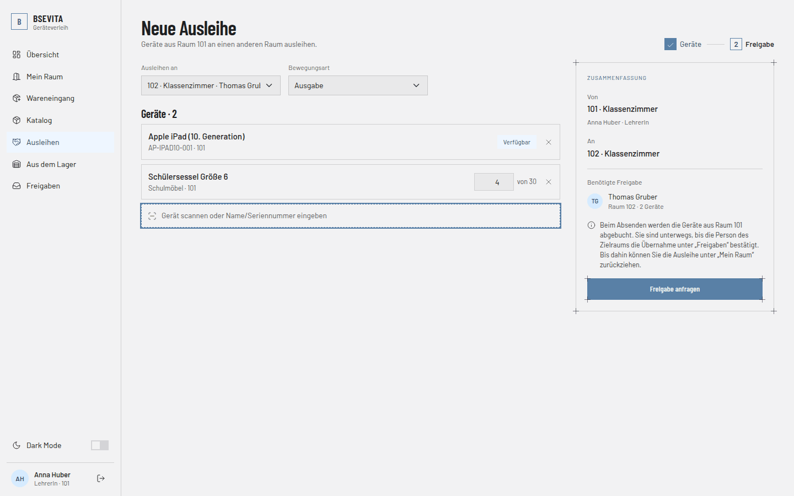

Die Schritte oben rechts (**1 Geräte → 2 Freigabe**) zeigen den Fortschritt. Nach dem Absenden landen Sie unter „Mein Raum“ mit einer Bestätigung, z. B. „Verleih von 2 Geräten an Raum 102 angefragt. Die Geräte sind unterwegs, bis Thomas Gruber die Übernahme bestätigt.“

Verleiht ein Admin aus einem Lager, landet er danach unter **Freigaben**. Dort steht die Anfrage in der Tabelle **„Von Ihnen aus einem Lager angefragt, noch nicht freigegeben“** und lässt sich mit **Zurückziehen** rückgängig machen. Die verantwortliche Person des Lagers sieht sie wie gewohnt unter „Mein Raum“.

> Wer für **keinen Raum** verantwortlich ist, sieht auf dieser Seite nur einen Hinweis, denn nur die verantwortliche Person darf Gegenstände aus einem Raum buchen. Admins verleihen auch ohne eigenen Raum aus den Lagern.

---

## 10. Rückgabe

Mit **Rückgabe** (bzw. **Zurückgeben** unter „Mein Raum“) geben Sie Geräte aus Ihrem Raum zurück. Zurückgegebene Geräte kommen **immer in das Umbuchungslager UL**, einen Zielraum wählen Sie daher nicht. Die Lagerbewegungen bekommen die Bewegungsart „Rückgabe“.

1. Menüpunkt **Rückgabe** öffnen. Die Seite zeigt den ganzen Bestand Ihres Raums als **Checkliste**. Bei mehreren eigenen Räumen wählen Sie den Raum oben über die Karten, wie unter [Mein Raum](#6-mein-raum).
2. Die Geräte **abhaken**, die zurückgehen. **Alle auswählen** hakt alle (gerade sichtbaren) Geräte ab, danach heißt der Knopf **Auswahl aufheben**.
3. Bei Mengenartikeln steht rechts die **Menge**, vorgeschlagen ist alles, was im Raum liegt („von …“). Sie zählt erst, wenn das Gerät abgehakt ist, und lässt sich dann verringern.
4. Das Suchfeld filtert die Liste nach Name, Seriennummer oder Kategorie. Mit einem USB-Handscanner eine Seriennummer einlesen: **Enter** hakt das passende Gerät ab und leert das Feld wieder. **Esc** hebt den Filter auf.
5. **Rückgabe anfragen** klicken (erst möglich, wenn mindestens ein Gerät abgehakt ist).

Danach geht es weiter wie beim Verleihen (siehe Kasten **Ablauf** rechts):

1. Die Geräte werden sofort in Ihrem Raum abgebucht.
2. Die verantwortliche Person des Umbuchungslagers oder ein Admin bestätigt die Rückgabe unter **Freigaben** (die Karte ist mit „Rückgabe“ markiert) oder lehnt sie ab.
3. Bis dahin sind die Geräte unterwegs. Unter **Mein Raum** können Sie die Rückgabe zurückziehen.
4. Nach der Bestätigung sind die Geräte im Bestand des Umbuchungslagers. Von dort lagert die Person des UL oder ein Admin sie mit **Verleihen** (z. B. Bewegungsart „Einlagerung“) wieder ins Hauptlager ein.

Nach dem Absenden landen Sie unter „Mein Raum“ mit einer Bestätigung, z. B. „Rückgabe von 4 Geräten an das Umbuchungslager UL angefragt. Die Geräte sind unterwegs, bis Lehrer Umbuchungslager die Rückgabe bestätigt.“

> Den Menüpunkt sehen **alle außer der Person, die nur für das Umbuchungslager verantwortlich ist**, denn dort kommen die Rückgaben an (ruft sie die Seite über die Adresse auf, bekommt sie Links zu **Freigaben** und **Verleihen**). Hat sie weitere Räume, gibt sie aus diesen zurück, das Umbuchungslager steht dann nicht zur Auswahl. Wer für **keinen Raum** verantwortlich ist, sieht nur einen Hinweis. Gibt es den Raum UL nicht oder ist niemand für ihn verantwortlich, kann nichts zurückgegeben werden, auch darauf weist die Seite hin.

---

## 11. Freigaben

*Für Personen mit eigenem Raum und für Admins.* Hier bestätigen Sie Anfragen, die **Sie** freigeben müssen:

* **Geräte, die jemand an Ihren Raum verleiht** (die Karte ist mit „Ausleihe“ markiert; bei mehreren eigenen Räumen stehen die Anfragen für alle Ihre Räume zusammen hier),
* **Rückgaben**, wenn Sie für das Umbuchungslager UL verantwortlich sind (die Karte ist mit „Rückgabe“ markiert), und
* **Geräte, die jemand aus Ihrem Lager holt** (wenn Sie für HL oder UL verantwortlich sind).

**Admins** sehen hier zusätzlich alle Anfragen, die ein **Lager** freigeben muss (Rückgaben ins UL, Holen aus HL oder UL, Verleih an ein Lager), auch ohne eigenen Raum. Der Untertitel nennt die Lager, z. B. „Anfragen für die Lager HL, UL (als Admin)“. Dazu gehören auch die eigenen Anfragen eines Admins an ein Lager (z. B. Einlagerung von UL nach HL), die er hier selbst freigeben oder ablehnen kann. Was ein Admin aus einem Lager an einen anderen Raum (kein Lager) verliehen hat, gibt die Person dieses Raums frei. Es steht darunter in **„Von Ihnen aus einem Lager angefragt, noch nicht freigegeben“** mit **Zurückziehen**.

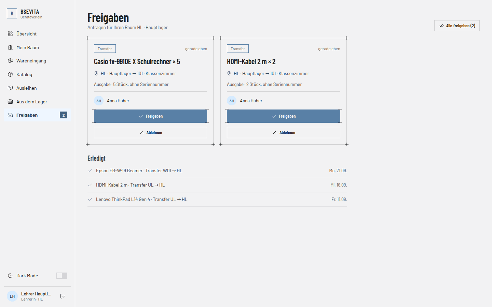

Jede Anfrage ist eine Karte mit Gegenstand, Menge, Von → Nach, Bewegungsart und der Person, die angefragt hat.

* **Freigeben**: Die Menge wird im Nach-Raum zugebucht, die Lagerbewegung ist bestätigt.
* **Ablehnen**: Nach einer Sicherheitsabfrage geht die Menge zurück in den Von-Raum, die Bewegung wird „Storniert“.
* **Alle freigeben (n)** oben rechts bestätigt alle offenen Anfragen auf einmal.

Nach dem Freigeben erscheint eine Bestätigung, und die Anfragen wandern in die Liste **Erledigt**:

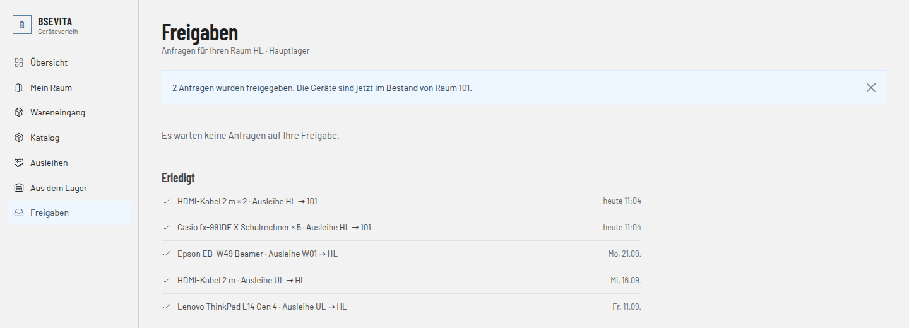

Beispiel aus Sicht des Zielraums 102: Thomas Gruber hat zwei Anfragen von Anna Huber (Raum 101) …

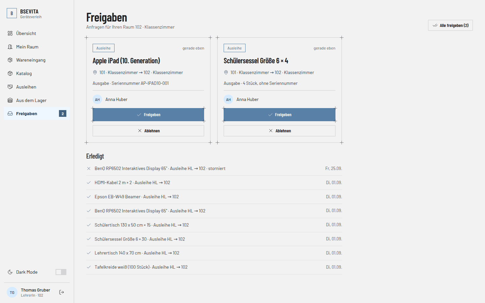

… und lehnt die Schülersessel ab. Sie sind sofort wieder im Bestand von Raum 101, die Ablehnung steht unter „Erledigt“ als *storniert*:

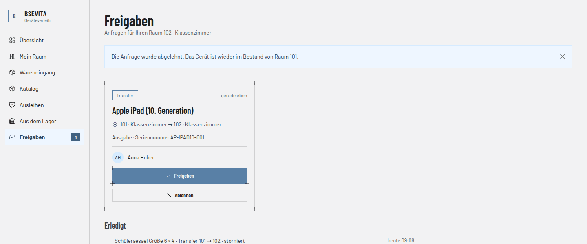

### Lebenszyklus einer Lagerbewegung

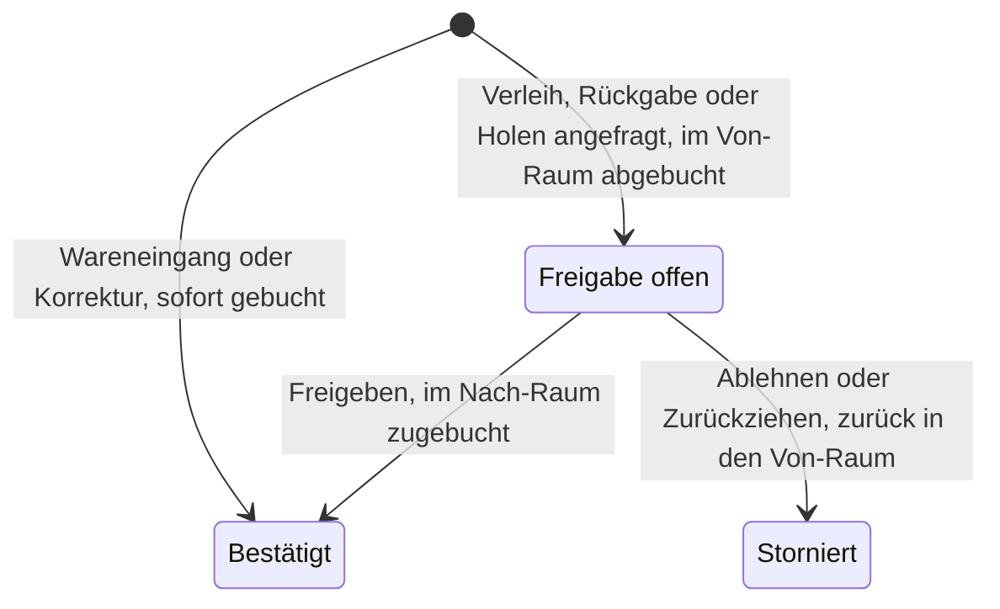

| Wer? | Verleihen aus Raum A nach Raum B | Rückgabe aus Raum A ins UL | Holen aus Lager L in Raum R |
|---|---|---|---|
| Anfragen | verantwortliche Person von **A** | verantwortliche Person von **A** | verantwortliche Person von **R** |
| Freigeben / Ablehnen | verantwortliche Person von **B** | verantwortliche Person von **UL** | verantwortliche Person von **L** |
| Zurückziehen | verantwortliche Person von **A** | verantwortliche Person von **A** | verantwortliche Person von **R** |

Ist einer der beteiligten Räume ein **Lager**, darf dort jeder Admin dasselbe wie die verantwortliche Person, auch eine selbst gestellte Anfrage freigeben. Beispiel: Ein Admin verleiht aus **HL** an Labor **309**, dann gibt die Person von 309 frei und der Admin (oder die Person von HL) kann zurückziehen.

---

## 12. Profil

Ein Klick auf Ihren Namen unten in der Seitenleiste öffnet Ihr Profil.

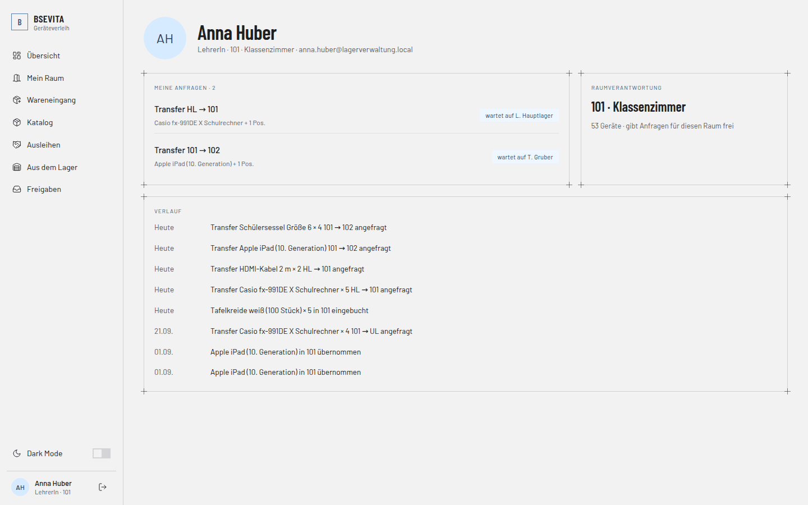

* **Kopf**: Name, Rolle, Raum und E-Mail.
* **Meine Anfragen**: Ihre offenen Anfragen und auf wen sie warten.
* **Raumverantwortung**: Ihre Räume mit Anzahl der Geräte.
* **Verlauf**: Ihre letzten Buchungen.

Admins können über die Benutzerverwaltung auch das Profil **anderer Personen** öffnen. Dort gibt es zusätzlich **Rolle ändern** und **Löschen** (das eigene Konto kann man nicht löschen):

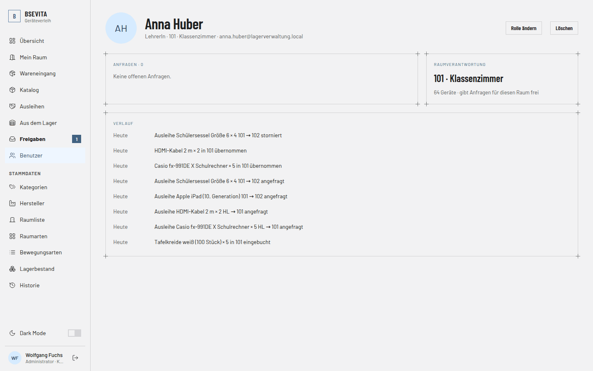

---

## 13. Administration

Alle Seiten in diesem Abschnitt sind **nur für Admins** sichtbar.

### 13.1 Benutzer

Menüpunkt **Benutzer**: links die Liste aller Benutzer mit Rolle, Raumverantwortung und Anzahl offener Ausleihen, rechts die Details der ausgewählten Person.

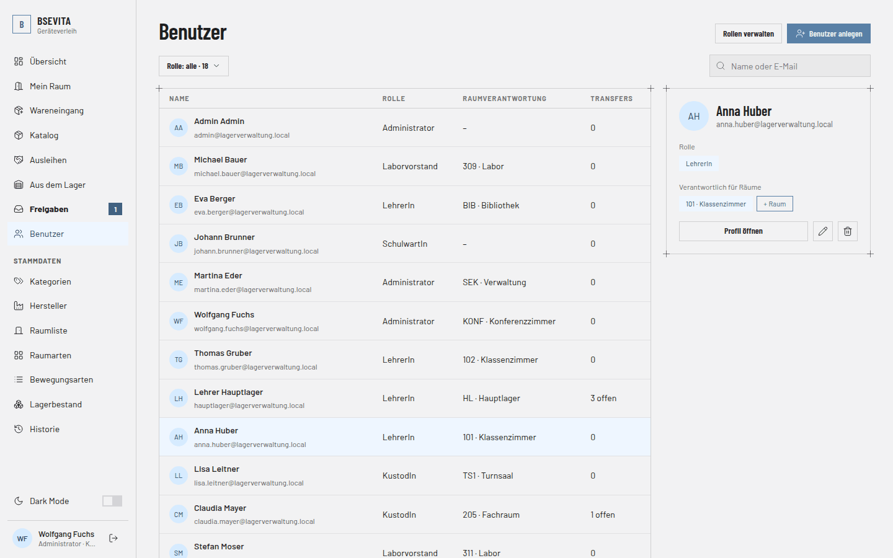

* **Rolle: alle** filtert die Liste nach Rolle, das Suchfeld rechts sucht nach Name oder E-Mail (mit Enter).
* Ein **Klick auf eine Zeile** zeigt die Person rechts. Dort gibt es **Profil öffnen**, **Bearbeiten** (Stift) und **Löschen** (Papierkorb).
* **+ Raum** führt zur Raumliste, denn die Raumverantwortung legt man beim Raum fest (siehe [13.2](#132-stammdaten)).

**Benutzer anlegen:** Oben rechts auf **Benutzer anlegen** klicken, Vorname, Nachname, Benutzername (eindeutig), Passwort (mindestens 5 Zeichen), E-Mail und Rolle eintragen, dann **Anlegen** klicken. Ein schon vergebener Benutzername wird mit „Dieser Benutzername ist bereits vergeben.“ abgelehnt.

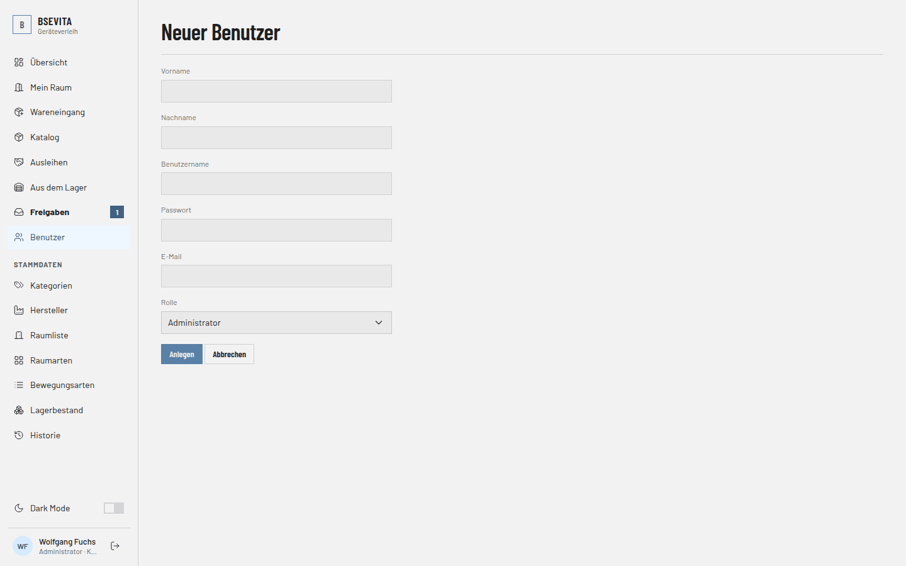

**Benutzer bearbeiten:** Bleibt das Feld **Neues Passwort** leer, behält die Person ihr bisheriges Passwort. So setzen Sie auch vergessene Passwörter zurück. Ein neues Passwort braucht mindestens 5 Zeichen. Mit dem Speichern endet jede bestehende Anmeldung dieser Person, auch auf anderen Geräten; sie muss sich mit dem neuen Passwort anmelden. Ändern Sie Ihr eigenes Passwort, bleiben Sie angemeldet.

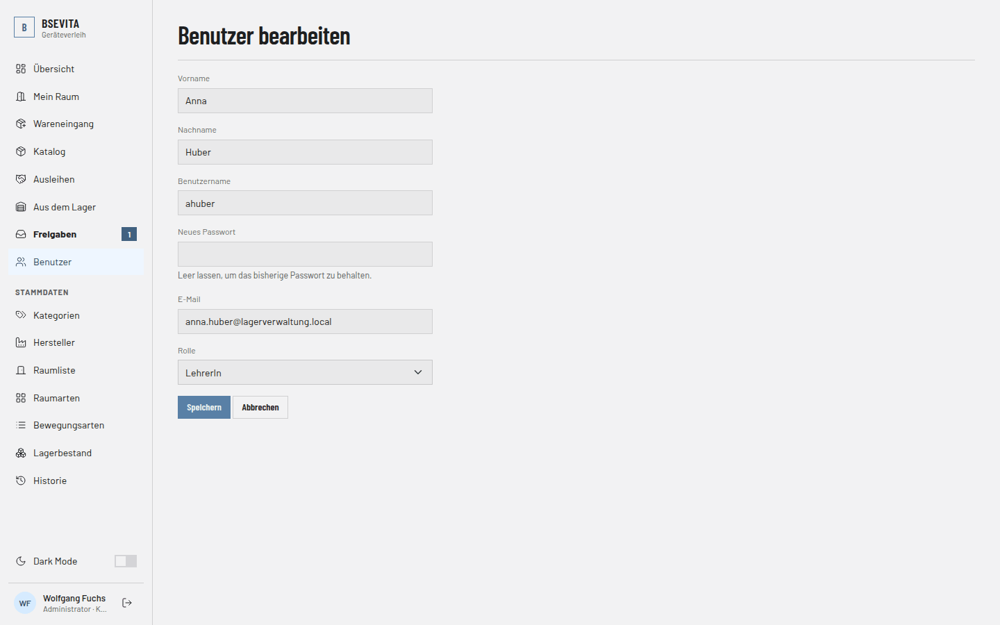

**Regeln beim Bearbeiten und Löschen:**

* Der **letzte Administrator** muss eine Admin-Rolle behalten und kann nicht gelöscht werden.
* Das **eigene Konto** kann man nicht löschen.
* Eine Person, die für einen **Raum verantwortlich** ist, kann erst gelöscht werden, wenn der Raum einer anderen Person zugewiesen ist.
* Eine Person, die **Lagerbewegungen erfasst** hat, kann nicht gelöscht werden (die Historie muss nachvollziehbar bleiben).

**Rollen verwalten:** Über **Rollen verwalten** (oben rechts) kommen Sie zur Liste der Rollen. Mit **Neue Rolle** legen Sie eine Rolle an, je Zeile gibt es **Details**, **Bearbeiten** und **Löschen**. Ist bei einer Rolle **Admin-Rechte** angehakt, bekommen alle Personen mit dieser Rolle Zugriff auf die Administration. In der Spalte **Benutzer** steht, wie viele Personen die Rolle haben; ein Klick auf die Zahl öffnet die Benutzerliste, gefiltert nach dieser Rolle. **Zurück zu den Benutzern** führt wieder zur Benutzerverwaltung.

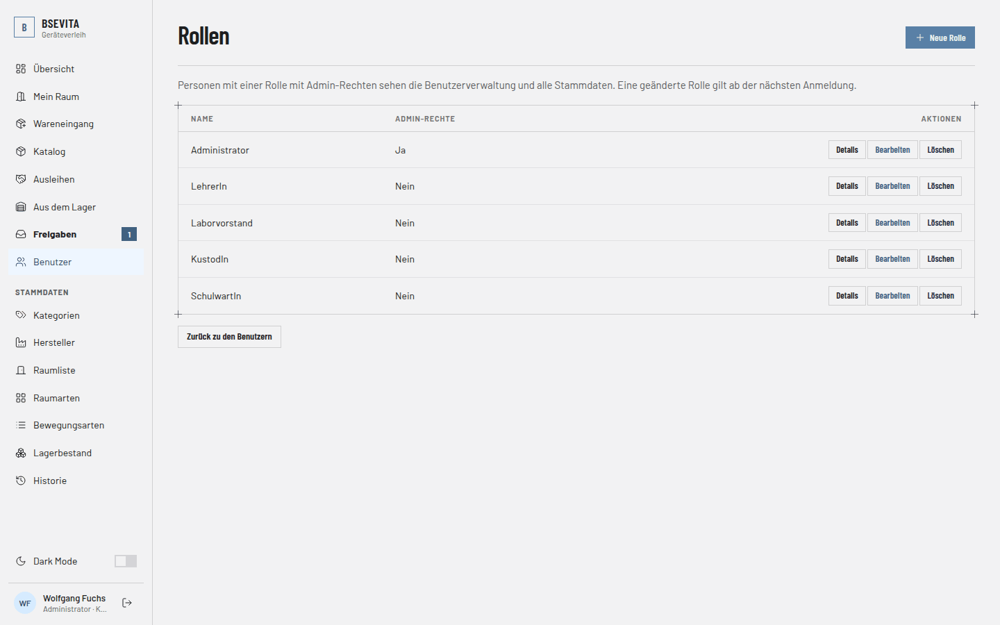

Eine Rolle kann nur gelöscht werden, wenn ihr **keine Personen** mehr zugeordnet sind. Die **einzige** Rolle mit Admin-Rechten, der noch Personen zugeordnet sind, kann das Häkchen **Admin-Rechte** nicht verlieren, sonst könnte niemand mehr Benutzer verwalten. Anlegen, Speichern und Löschen einer Rolle bestätigt eine Meldung (z. B. „Rolle "LehrerIn" wurde angelegt.“).

> Rolle, Admin-Recht und Raumverantwortung gelten sofort: Ändert ein Admin die Rolle einer Person oder das Häkchen **Admin-Rechte** einer Rolle, gilt das bei der nächsten Seite, die die Person aufruft, eine erneute Anmeldung ist nicht nötig. Ob jemand Admin ist, hängt allein an diesem Häkchen, nicht am Namen der Rolle. Ein gelöschter Benutzer ist sofort abgemeldet.

### 13.2 Stammdaten

Alle Stammdaten-Seiten funktionieren gleich: eine Liste mit **Neu**-Button oben rechts und je Zeile **Details**, **Bearbeiten** und **Löschen**. Anlegen, Speichern und Löschen bestätigt jeweils eine Meldung (z. B. „Raumart "Labor" wurde angelegt.“).

#### Kategorien

Die Liste zeigt jede Kategorie mit der Anzahl ihrer Gegenstände.

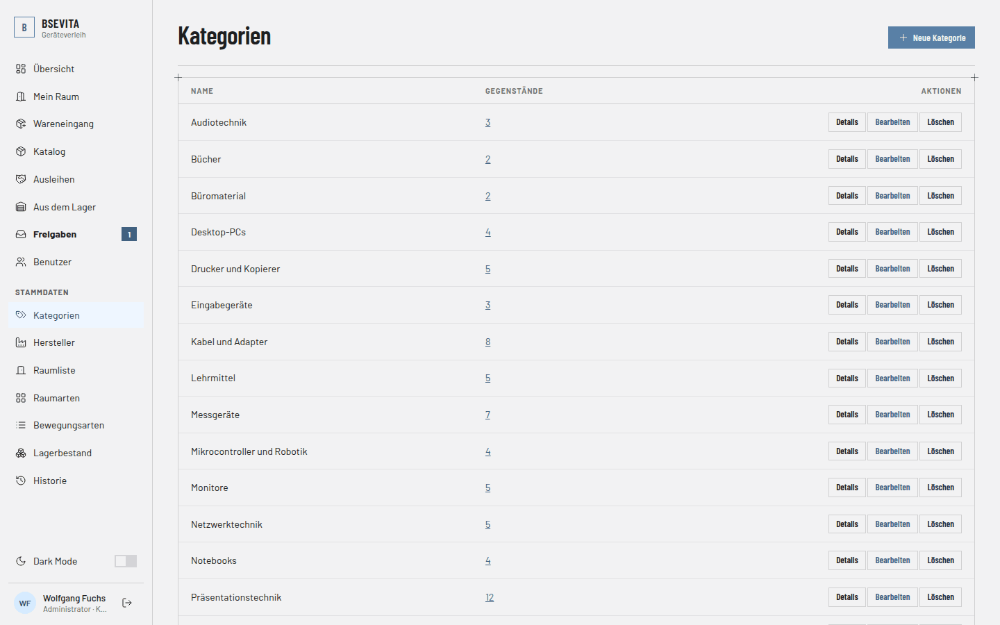

**Neue Kategorie** öffnet ein Formular mit nur einem Feld (Name). Die Formulare für Hersteller, Raumarten und Bewegungsarten sehen genauso aus:

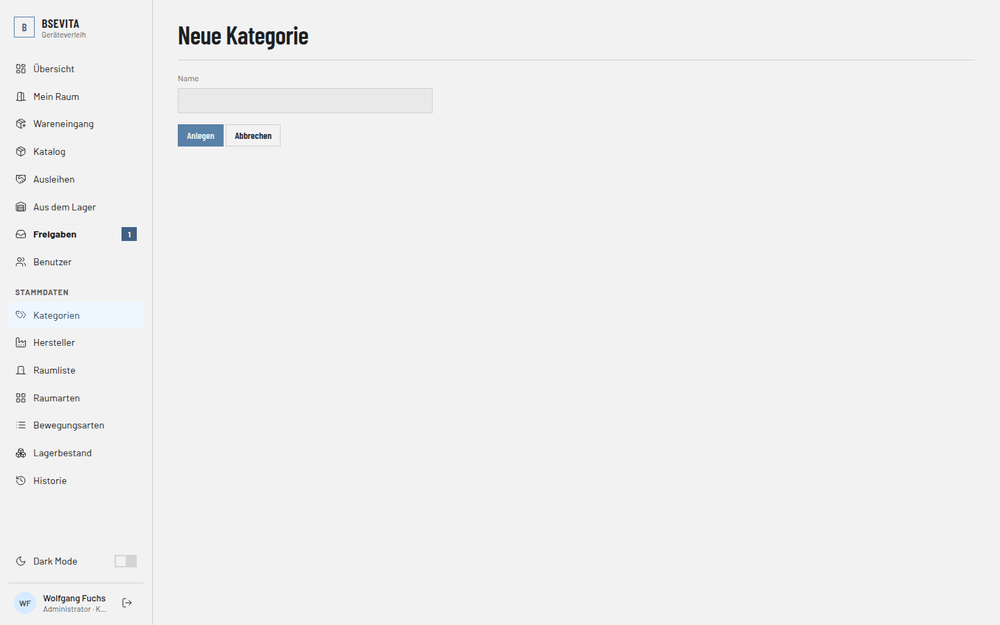

* Jeder Name darf nur einmal vorkommen („Diese Kategorie gibt es bereits.“). Leerzeichen am Anfang und Ende entfernt die App, „ Kabel“ ist also derselbe Name wie „Kabel“. Das gilt auch für Hersteller, Raumarten und Bewegungsarten.
* Eine Kategorie kann nur gelöscht werden, wenn ihr **keine Gegenstände** mehr zugeordnet sind.

#### Hersteller

Funktioniert wie die Kategorien: Name eindeutig, Löschen nur ohne zugeordnete Gegenstände. Ein Klick auf die **Anzahl der Gegenstände** öffnet den Katalog, gefiltert nach diesem Hersteller.

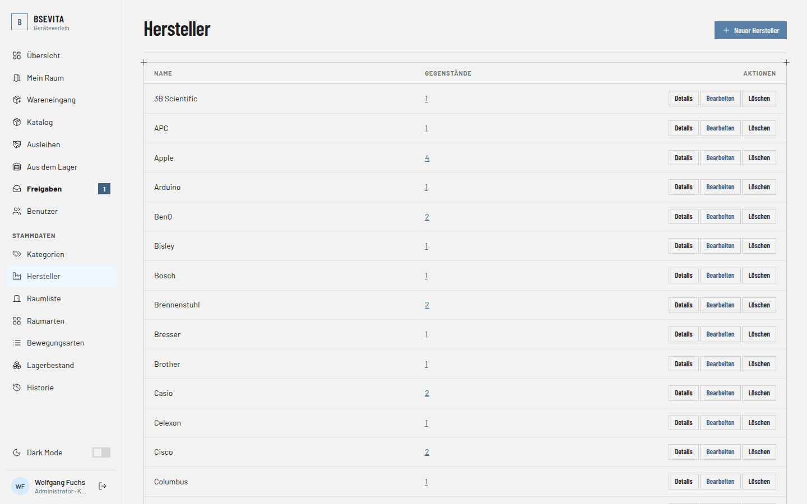

#### Raumliste

Menüpunkt **Raumliste**: alle Räume mit Raumart und verantwortlicher Person.

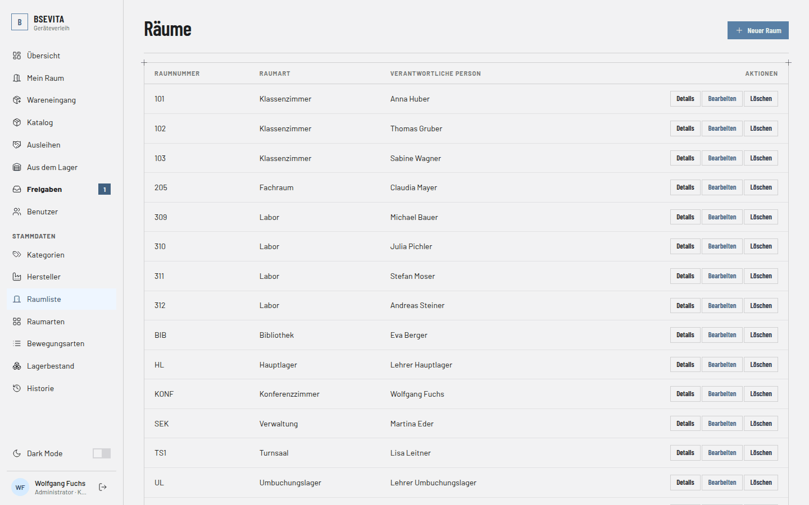

**Details** zeigt neben Raumart und verantwortlicher Person den **Bestand** des Raums: oben die Summe (z. B. „76 Stück in 11 Einträgen“, bei einem leeren Raum „leer“), darunter alle Gegenstände, die gerade im Raum liegen, mit Seriennummer, Kategorie, Hersteller und Menge. Ein Klick auf einen Gegenstand öffnet seine Details mit dem Verlauf. Geräte, die gerade unterwegs sind, stehen hier nicht, denn sie sind im Von-Raum schon abgebucht und im Nach-Raum noch nicht angekommen.

**Neuer Raum:**

1. **Raumnummer** eingeben (max. 8 Zeichen, nur Buchstaben, Ziffern, Punkt, Binde- und Unterstrich, aber nicht nur Punkte wie „..“). Sie **kann später nicht mehr geändert werden**.
2. **Raumart** auswählen.
3. **Verantwortliche Person** auswählen. Angeboten werden alle Personen: Ein Raum hat höchstens eine verantwortliche Person, eine Person kann aber für mehrere Räume verantwortlich sein.

**Raum bearbeiten:** Hier ändern Sie Raumart und verantwortliche Person. Ohne verantwortliche Person kann nichts aus diesem Raum gebucht werden. Die Person lässt sich nur entfernen oder wechseln, solange **keine offene Lagerbewegung** den Raum betrifft. Sonst meldet die App, dass diese zuerst bestätigt, abgelehnt oder zurückgezogen werden müssen. Bei einem Wechsel wäre sonst nicht mehr klar, wer eine offene Anfrage gestellt hat und wer sie freigeben muss: Die neue Person könnte sich zum Beispiel das Holen aus einem Lager selbst freigeben.

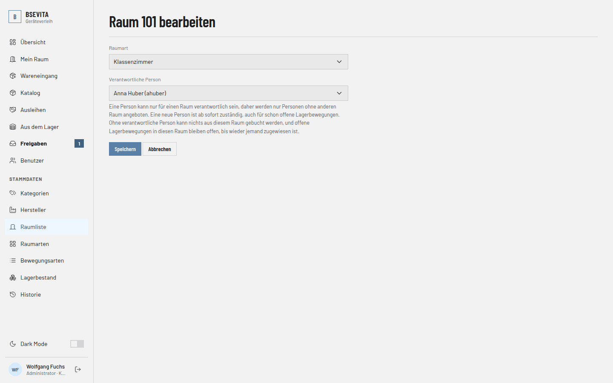

**Raum löschen** geht nur, wenn der Raum **leer** ist und in **keiner Lagerbewegung** vorkommt.

#### Raumarten

Eine Raumart beschreibt einen Raum nur näher (z. B. Labor). Wer buchen und bestätigen darf, hängt **nicht** von der Raumart ab, sondern nur von der verantwortlichen Person. Einzige Besonderheit: Räume, deren Raumart „lager“ im Namen trägt (z. B. *Hauptlager*, *Umbuchungslager*), erscheinen unter [Aus dem Lager holen](#8-aus-dem-lager-holen).

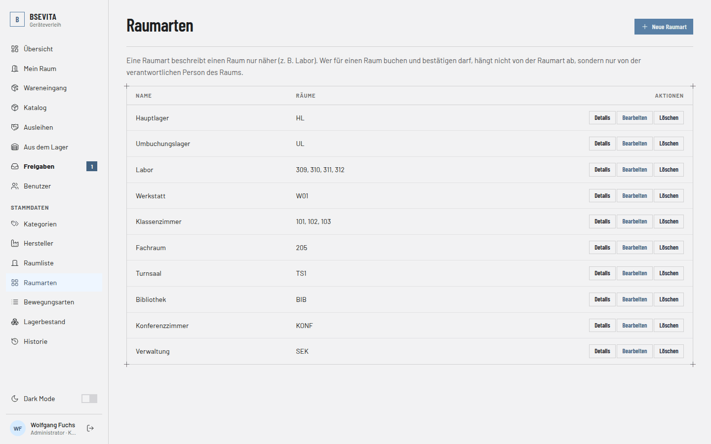

Die Spalte **Räume** zeigt, welche Räume diese Raumart haben; die Details einer Raumart listen die Räume mit Link auf. Jeder Name darf nur einmal vorkommen („Diese Raumart gibt es bereits.“). Löschen geht nur, wenn **kein Raum** mehr diese Raumart hat.

#### Bewegungsarten

Eine Bewegungsart beschreibt eine Lagerbewegung nur näher (z. B. Ausgabe, Einlagerung, Reparatur) und gibt keine Regeln für den Ablauf vor. Jeder Name darf nur einmal vorkommen („Diese Bewegungsart gibt es bereits.“), sonst ließen sich zwei gleichnamige beim Buchen nicht unterscheiden.

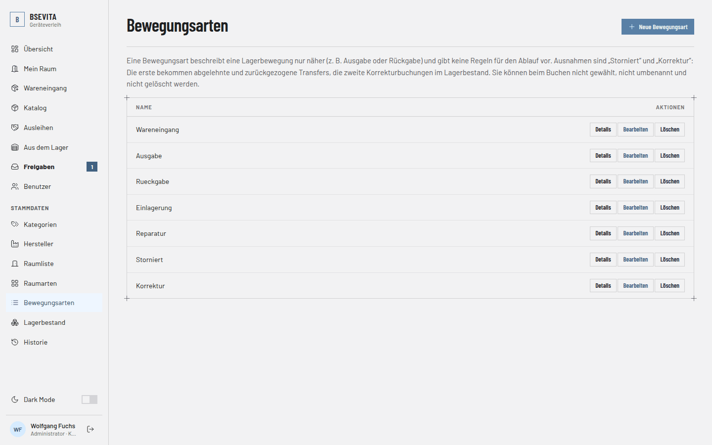

> **Ausnahmen:** „Storniert“ (für abgelehnte und zurückgezogene Ausleihen), „Korrektur“ (für Korrekturbuchungen im Lagerbestand) und „Rückgabe“ (für [Rückgaben](#10-rückgabe) an das Umbuchungslager) vergibt die App selbst. Sie können beim Buchen nicht gewählt, nicht umbenannt und nicht gelöscht werden.

Auch eine Bewegungsart, die schon in einer **Lagerbewegung vorkommt**, kann nicht gelöscht werden, sonst wäre die Historie nicht mehr vollständig. Umbenennen geht aber.

### 13.3 Lagerbestand (Korrektur)

Mit **Lagerbestand** korrigieren Admins den Bestand eines Raums, z. B. nach einer Inventur.

1. Oben den **Raum** auswählen. Die Seite lädt sofort den Bestand dieses Raums.
2. In der Spalte **Neue Menge** die gezählte Menge eintragen. Geräte mit Seriennummer sind entweder da (1) oder nicht (0).
3. Fehlt ein Gegenstand im Raum, wählen Sie ihn unter **Gegenstand hinzufügen** aus und geben die Menge ein.
4. **Korrektur buchen** klicken. **Zurücksetzen** verwirft die Eingaben.

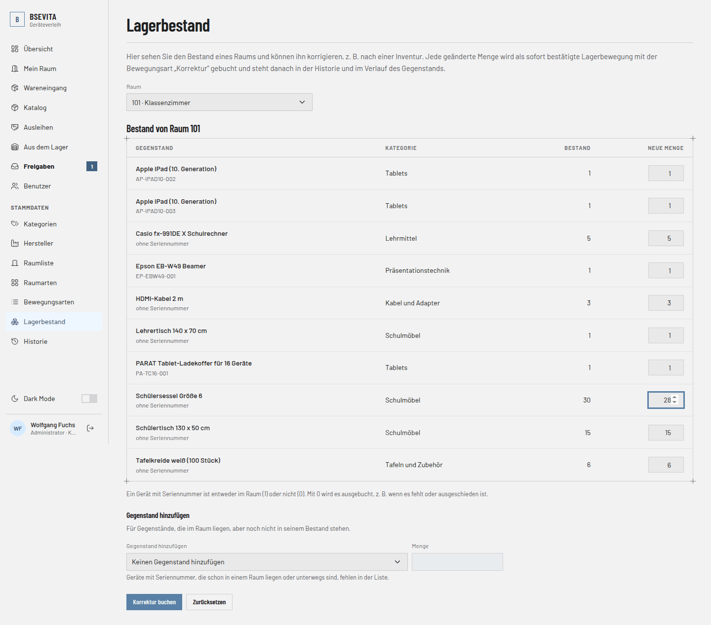

Jede geänderte Menge wird als **sofort bestätigte Lagerbewegung** mit der Bewegungsart „Korrektur“ gebucht und erscheint in der Historie (die Menge ist dort die Änderung, z. B. −2).

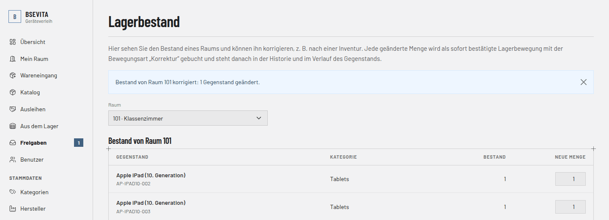

> Hat sich der Bestand zwischen Anzeigen und Buchen geändert (z. B. durch einen Verleih), bricht die Korrektur ab. Dann die Seite neu laden und neu zählen. Wie beim Wareneingang gibt es von einem Gegenstand insgesamt höchstens 100.000 Stück.

### 13.4 Historie

Die **Historie** listet **alle Lagerbewegungen**, die neueste zuerst, mit 50 Einträgen pro Seite.

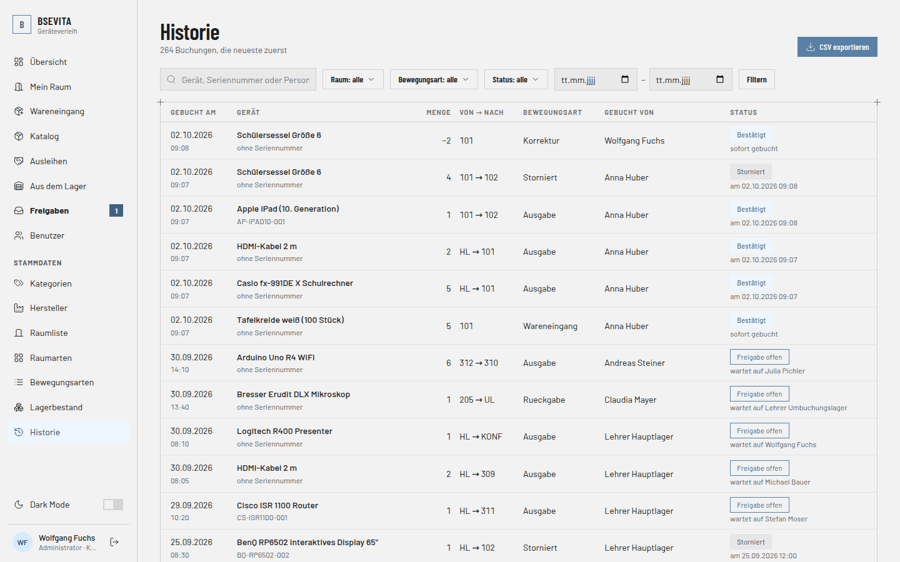

Spalten: gebucht am, Gerät, Menge, Von → Nach, Bewegungsart, gebucht von und Status:

* **Freigabe offen** mit „wartet auf …“,
* **Bestätigt** mit Zeitpunkt („sofort gebucht“ bei Wareneingang und Korrektur),
* **Storniert** mit Zeitpunkt der Stornierung.

**Filtern:** Suchfeld (Gerät, Seriennummer oder Person), **Raum**, **Bewegungsart**, **Status** und ein **Zeitraum** (von – bis). Dann **Filtern** klicken. **×** setzt alle Filter zurück. Beispiel: alle offenen Freigaben im September:

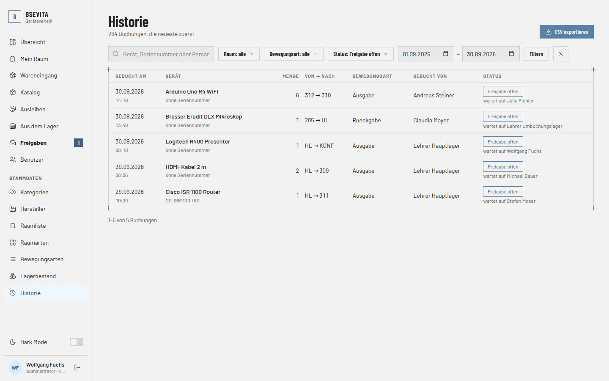

Ein Klick auf eine Zeile öffnet die Details des Gegenstands mit seinem Verlauf.

**CSV exportieren** lädt **alle** Lagerbewegungen (unabhängig vom Filter, älteste zuerst) als Datei `Lagerbewegungen_JJJJ-MM-TT.csv` herunter. Die Datei ist mit Strichpunkt getrennt und UTF-8-kodiert, sodass Excel mit deutschen Einstellungen Spalten und Umlaute richtig erkennt. Spalten: *Gebucht am; Abgeschlossen am; Status; Bewegungsart; Gegenstand; Seriennummer; Menge; Von Raum; Nach Raum; Gebucht von*.

---

## 14. Mobile Ansicht

Auf dem Smartphone passt sich die App an: Statt der Seitenleiste gibt es unten eine **Tab-Leiste** mit **Übersicht**, **Katalog**, **Rückgabe** (nicht für die Person des Umbuchungslagers), **Freigaben** (mit Badge) und **Profil**. Alle weiteren Bereiche, den Dark-Mode-Schalter und **Abmelden** finden Sie unter **Profil**.

<table>
  <tr>
    <td align="center">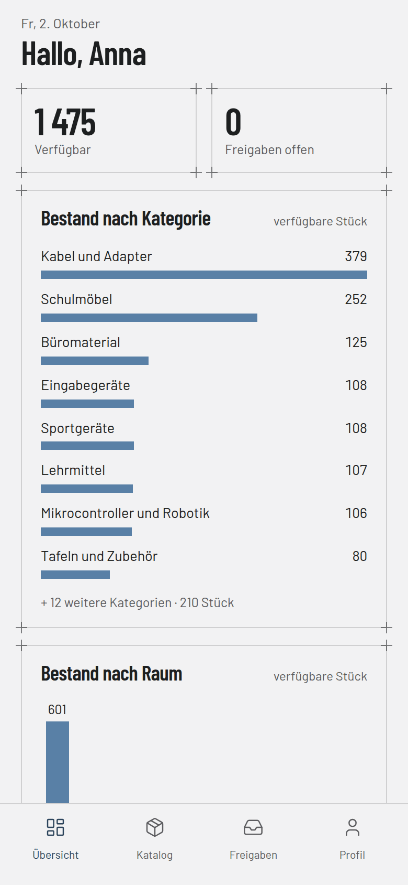 Übersicht</td>
    <td align="center">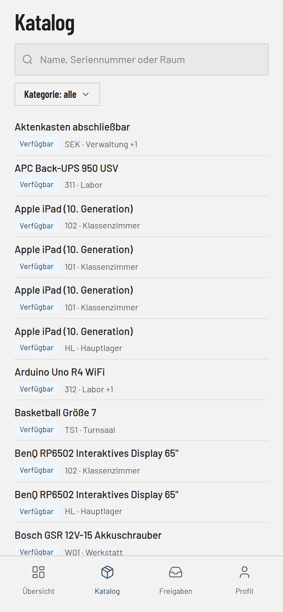 Katalog</td>
    <td align="center">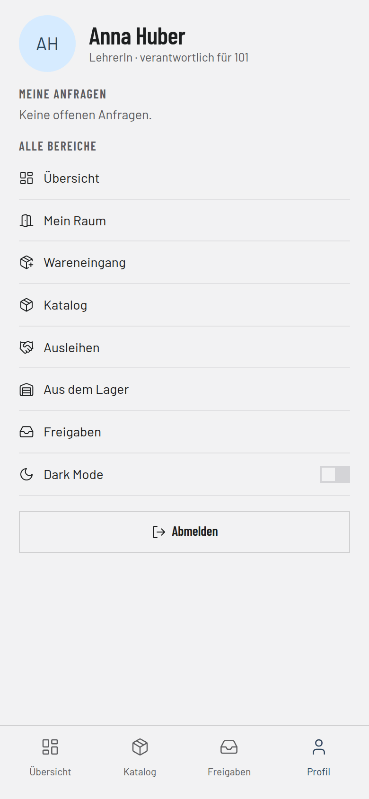 Profil mit allen Bereichen</td>
  </tr>
</table>