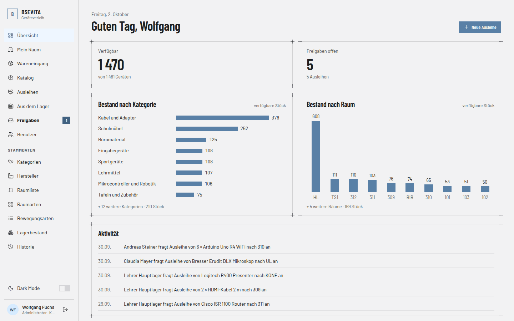

# Lagerverwaltung – BSEVITA Geräteverleih

Webanwendung, mit der die Schule verwaltet, welche Geräte und Materialien sich in welchem Raum befinden. Jede Änderung am Bestand wird als **Lagerbewegung** gebucht und bleibt in der Historie nachvollziehbar.

## Funktionen

* **Übersicht**: Verfügbarer Bestand, offene Freigaben, Diagramme nach Kategorie und Raum sowie die letzten Buchungen in einer Aktivitätenliste.
* **Katalog**: Alle Gegenstände mit Suche und Filter nach Kategorie, Raum, Status und Hersteller, die sich mit einem Klick zurücksetzen lassen. Admins erfassen, bearbeiten und löschen Gegenstände.
* **Mein Raum**: Bestand des eigenen Raums, offene Anfragen und Übernahmen.
* **Wareneingang**: neue Gegenstände (z. B. nach einer Lieferung) in den eigenen Raum einbuchen, ausgewählt aus einer durchsuchbaren Liste mit Kategoriefilter.
* **Aus dem Lager holen** und **Verleihen**: Geräte aus dem Hauptlager bzw. Umbuchungslager anfordern oder an einen anderen Raum weitergeben. Die Geräte lassen sich suchen oder aus der Bestandsliste hinzufügen, von der Detailseite eines Geräts aus ist es schon ausgewählt.
* **Rückgabe**: Geräte des eigenen Raums wie in einer Checkliste abhaken (auch per Scanner) und an das Umbuchungslager zurückgeben.
* **Freigaben**: Die verantwortliche Person des Zielraums bzw. Lagers bestätigt oder lehnt Anfragen ab. Bis dahin kann die anfragende Person die Anfrage zurückziehen.
* **Administration**: Benutzer und Rollen, Stammdaten (Kategorien, Hersteller, Räume, Raumarten, Bewegungsarten), Bestandskorrektur nach einer Inventur und Historie aller Lagerbewegungen mit Filter und CSV-Export.
* Dark Mode und eigene Ansicht für Smartphones.

Was jemand sehen und tun darf, hängt von der **Rolle** (mit Admin-Rechten oder ohne) und der **Raumverantwortung** ab: Jeder Raum hat höchstens eine verantwortliche Person, eine Person kann aber für mehrere Räume verantwortlich sein. Nur sie darf aus ihren Räumen buchen und Anfragen dafür freigeben. Eine geänderte Rolle gilt sofort, ohne erneute Anmeldung.

## Technik

* ASP.NET Core MVC mit .NET 10
* Entity Framework Core mit SQL Server (Standard: LocalDB)
* Anmeldung per Cookie, Passwörter (mindestens 5 Zeichen) mit Hash und Pepper; nach 5 Fehlversuchen wird der Benutzername gesperrt, mit jedem weiteren Fehlversuch eine Minute länger
* Bootstrap, jQuery und Lucide-Icons im Frontend

## Starten

1. `Docs/Datenbankskript.sql` in SQL Server Management Studio 22 ausführen. Das Skript legt die Datenbank `Lagerverwaltung` an.
2. *(Optional)* Testdaten mit `Lagerverwaltungsapp-MatthiasUtrata/Testdaten.sql` einspielen.
3. Verbindung bei Bedarf in `appsettings.json` unter `ConnectionStrings:DefaultConnection` anpassen.
4. `Lagerverwaltung.slnx` in Visual Studio starten mit einem Klick auf den grünen Pfeil in der Leiste oben.
5. Im Browser `https://localhost:7019` bzw. `http://localhost:5191` öffnen.

Ist die Datenbank leer, erscheint statt der Anmeldung die Registrierung. Die erste Person, die sich registriert, wird Administrator. Mit Testdaten kann man sich z. B. als `admin` / `admin` anmelden. Alle Testkonten stehen im [Tutorial](Docs/Tutorial.md#2-anwendung-starten-und-testkonten).

## Projektstruktur

| Ordner / Datei | Inhalt |
|---|---|
| `Lagerverwaltungsapp-MatthiasUtrata/` | Quellcode der Anwendung (Controllers, Extensions, Filters, Models, Services, Views) |
| `Docs/` | Datenbankskript, ER-Diagramm und technische Dokumentation |
| `Docs/Mockups/` | Screenshots der Oberfläche |
| `Docs/Tutorial.md` | Ausführliche Bedienungsanleitung mit allen Seiten |

## Autor
Matthias Utrata
